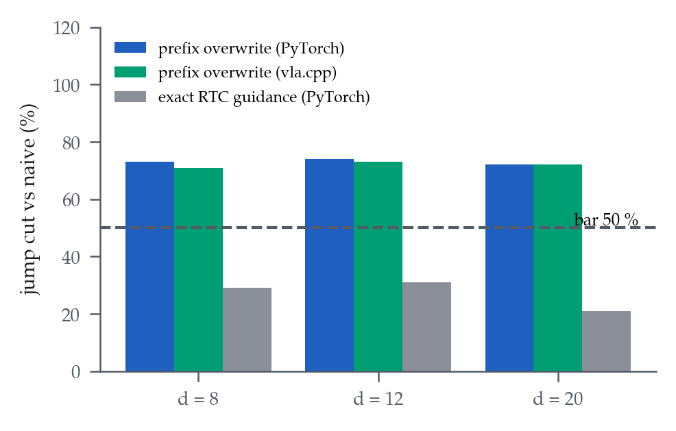
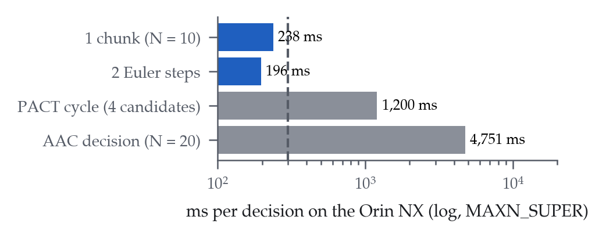

# Vision is the bottleneck: seven action-chunking tricks for a VLA, re-measured on a Jetson Orin NX

*Ravindu Somawansa, Shisso Robotics. Draft, 4-page workshop version. Rendered by `make_paper.py` from the result
files: every number below is a placeholder filled from `numbers.json`, which records each value's anchor. Nothing new
was run.*

## Abstract

We re-measured seven training-free methods for action chunking in flow-matching VLAs, among them exact real-time chunking, speculative chunk selection and entropy-adaptive chunk length. Their papers report numbers from desktop GPUs. We ran them where a low-cost robot runs its policy, with SmolVLA on a Jetson Orin NX. All tests share one checkpoint and the same recorded episodes. Each test had its threshold committed before the run, and every number traces to a result file and a protocol commit. On this board the vision encoder takes 151.0 of 219.0 ms of server time per chunk (25 W). The two methods that act on the seam between chunks pass. A gradient-free prefix overwrite cuts the boundary jump by 72 % or more. Movement-primitive seam conditioning removes most of the seam jerk. The sampling methods do not transfer on vla.cpp, which samples in sequence, so every N-sample method pays for N chunks one after another. That is the engine and not the board. In PyTorch on the same Orin, four candidates that share one vision and prefill pass and one batched denoising loop cost 1.03 chunks.

## 1 Introduction

Several training-free chunking tricks for flow-matching VLAs came out this year, and their numbers come from desktop or data-centre GPUs (RTX 4090, A100, H100, RTX 5090). On these a chunk costs barely tens of milliseconds and spare compute is plentiful. A robot people can buy runs its policy on an edge GPU. There most of the chunk goes to the vision encoder, which these tricks don't affect. We measured how much of each trick is left on such a board.

Our robot is an SO-101 arm [arXiv:2606.08881] with a Jetson Orin NX 16 GB. It runs SmolVLA [arXiv:2506.01844] through
vla.cpp, a C++ inference engine, on episodes recorded with LeRobot. This paper started once SmolVLA ran on the arm
through vla.cpp. We then looked at where the rest of a chunk's time went, and at which published tricks could still
help. We took seven of them. Each one is a gate with a bar committed before the number. Offline effects get an episode
bootstrap, and latencies are medians of at least 50 calls. The appendix maps every number to its result file and
protocol commit.

## 2 Where the time goes

We follow one chunk of ten Euler steps at full power (MAXN_SUPER). It costs 237.5 ms end to end (Fig. 1). Vision
takes 150.7 ms and prefill 14.9 ms. Each denoise step takes 5.3 ms. At 25 W the
server-side split is 151.0 ms of vision in 219.0 ms.

> **Finding.** A trick that only touches the denoising loop works on 22 % of a chunk at most.

The Orin ran in two power modes for this paper. The serving split and the boundary experiments ran at 25 W. The latency experiments ran at full power. The protocol of each gate froze its mode, and every number below carries it.


## 3 Seven tricks, one checkpoint

All offline effects use the same SmolVLA checkpoint and the same 20 recorded episodes, with 254 chunk boundaries per
delay. Table 1 gives every effect, bar and verdict.

Two tricks act on the seam between chunks, and both pass. We start with the prefix overwrite, which replaces the executed prefix of the new chunk with the actions already committed. We ran it in PyTorch and in vla.cpp and it passes the 50 % jump-cut bar at every delay. In vla.cpp it adds 0.4 ms per chunk. The second is movement-primitive chunking [arXiv:2610.39451]. We projected each chunk onto ten Gaussian bases, which keeps the error within its bar and removes within-chunk jerk. Conditioning on the last action sent removes 83–87 % of the seam jerk at +0.19° of error, and the paper reports 73–84 %. We measured on the commanded stream only.

The overwrite needs no gradient. In our PyTorch reference (`repro/chunk-boundary/scripts/run_g13b_rtc_offline.py`) it
is the last branch of the guided denoising step, where `W` holds the prefix weights and `Y` the committed actions:

```python
            with torch.no_grad():
                v = original_denoise_step_partial(x)
            x1 = x - t * v
            err = (Y - x1) * W
            if self.method == "identity":
                out = v - guidance_weight(t, self.beta) * err
            else:  # overwrite: x1_hat <- x1_hat + W (Y - x1_hat), v' = (x_t - x1_hat') / t
                out = v - err / max(t, 1e-6)
```

Exact real-time chunking [arXiv:2506.07339] inpaints the prefix with guidance instead of overwriting it. We ran it and it cuts the jump by less than 50 % at every delay (Fig. 2). In PyTorch it costs 1.9× a naive chunk.

We ran the reduction of Euler steps from ten to two [arXiv:2610.32102] and it saves 41 ms per chunk at full power. The vision cost is much larger. The paper claims that the action cloud contracts around an unchanged centroid, with a cloud ratio of 0.51 on π0. Our ratio is 0.78. That is between the bar of 0.70 and the fail line of 0.85, so the claim is not proven here. The paper also expects fewer steps to remove edge-GPU thermal throttling. Our Orin did not throttle at ten steps in either power mode. We keep ten steps, as the protocol says while the contraction is unproven.

Two tricks sample several chunks per decision. Speculative chunk selection [arXiv:2610.28019] samples four candidates.
It uses the pre-commit frame to pick the one closest to the recorded teleoperation continuation. Offline it beats a
random pick (one continuation per frame, training-set episodes, open loop). Its paper promises no added control-step
delay. On the Orin, vla.cpp samples the candidates in sequence. A cycle costs 1,200 ms and 37 control
ticks, against 8 for a naive chunk (Fig. 3). Entropy-adaptive chunk length [arXiv:2604.04161] samples 20
chunks per decision. One decision takes 4,751 ms on the Orin. The threshold was 298 ms. The chosen
length also sits at the floor in both task phases. The jump is no better than with fixed chunks and the overwrite. We then took the sampling out of the engine. In PyTorch on the Orin at MAXN_SUPER, one chunk takes 1,060 ms, and four chunks in series take 4,239 ms. Four candidates that share one vision and prefill pass and one batched denoising loop take 1,092 ms, which is 1.03 times one chunk. The bar was 2.0, so the series cost of N samples belongs to a sequential engine and not to this GPU. Twenty candidates take 1,803 ms batched, 1.70 times one chunk, against 21,212 ms in series. The extra GPU memory is 49 MB for four candidates and 166 MB for twenty. A PyTorch chunk costs 4.5 times a vla.cpp chunk, so these rows are not mixed with the vla.cpp rows.

Table 1: Seven tricks on one checkpoint: what each acts on, its offline effect, the pre-registered bar, the verdict and its cost on the Orin NX.

| trick | acts on | offline effect | bar | verdict | cost on the Orin | mode |
|---|---|---|---|---|---|---|
| prefix overwrite | seam | jump −71 / −73 / −72 % (vla.cpp, d = 8/12/20); PyTorch −73 / −74 / −72 % | cut ≥ 50 % | pass | +0.4 ms per chunk | 25 W |
| exact RTC guidance | seam | jump −29 / −31 / −21 % | cut ≥ 50 % | fail | 1962 vs 1028 ms naive (1.9×, PyTorch) | 25 W |
| MP projection | within-chunk jerk | error -0.020°, jerk −94 % | error ≤ +0.30° | pass | < 1 ms | — |
| seam conditioning | seam jerk | −83 % (overlap 25) / −87 % (sync) at +0.19° | seam jerk ≤ 0.40× | pass | < 1 ms | — |
| two Euler steps | denoise loop | cloud ratio 0.78 (CI 0.73–0.81) | ≤ 0.70 | not proven | 196.1 vs 237.5 ms per chunk | MAXN_SUPER |
| speculative selection (PACT) | chunk choice | -0.27° vs a random pick (CI -0.44 to -0.09) | CI < 0, no added delay | selection pass, delay fail | 1,200 ms per cycle, 37 ticks vs 8 | MAXN_SUPER |
| adaptive length (AAC) | chunk length | h* 2 / 2 (transport / grasp); jump 0.973 vs 0.940 | transport ≥ grasp + 2; N = 20 ≤ 298 ms | fail | 4,751 ms per decision | MAXN_SUPER |





## 4 What transfers to the board

> **What transfers.** The prefix overwrite and the primitive projection with seam conditioning act on the seam. Each costs under a
> millisecond on this board. We keep ten Euler steps until the contraction passes its threshold. The two-step saving is
> small next to vision. Exact guidance, speculative selection and adaptive length all pay for N chunks in series on a sequential engine. A batched sampler does not, since four candidates cost 1.03 chunks in PyTorch on this board. If you run one of them on an edge board, check first whether your engine samples in a batch, because vla.cpp does not. This version is offline and latency only. The closed-loop columns on the arm, for seam
> smoothing and for the overwrite in the robot client, belong to a longer version.

## 5 Related work

Other chunking tricks are also reported on desktop-class GPUs. We did not re-measure them here. One extends the
executing chunk instead of resampling [arXiv:2610.05719]. One drives reactive chunking with a latent world model
[arXiv:2606.18589]. One fine-tunes the policy for latency with reinforcement learning [arXiv:2608.23831]. On the
engine side, TurboVLA [arXiv:2607.27205] pushes VLA throughput on a desktop GPU. vla.cpp, the engine we measure, runs
VLAs on edge boards. Two works use the same arm to evaluate policies. A standardized benchmark reports failures and
recoveries of VLA policies [arXiv:2606.08881]. A fleet of SO-101 cells evaluates policies at scale [arXiv:2607.24481].
We re-measure the execution tricks around one policy, under bars fixed before the run.

## 6 Limitations

The sampling result depends on the engine. vla.cpp samples sequentially. We contribute to vla.cpp, and the overwrite
runs on our fork (`ravediamond/vla.cpp`). Parity and determinism checks against PyTorch on the same board are in the
gate logs. The batched control ran in PyTorch because vla.cpp has no batched sampler, so the vla.cpp rows keep their sequential costs. It used five observations of the bowls task. Effects other than latency are
offline. They come from 20 recorded demonstrations of one task family (bowls), and the policy was trained on them. The
arm gates for seam smoothing and for the overwrite in the robot client have not run. We left out the adaptive-length
arm gate because SmolVLA is at ceiling on this task, so a gain could not show. Latency rows run at MAXN_SUPER, and the
serving and boundary rows at 25 W. Power mode is a confound wherever the two are compared. The study covers one
policy, SmolVLA at 450M. π0-class models do not fit on the Orin.

## Appendix: from plain name to gate

Every number in this paper is recomputable from the repository; this table maps each experiment to its files.

| experiment | repro folder | expected files | protocol commit | bar |
|---|---|---|---|---|
| serving split (25 W) | repro/glat2 | glat2_gpu640_summary.json | 82fdc15 | overhead ≤ 100 ms, ≤ 2 % over the 238 ms baseline |
| latency split, two Euler steps | repro/horizon-depth | a2_latency.json, a1_cloud.json | 0a79846 | cloud ratio ≤ 0.70; N = 2 ≤ 0.85 × N = 10 |
| chunk boundary (overwrite, exact) | repro/chunk-boundary | g13b_summary.json, g13b_preflight.json, vlacpp_overwrite_summary.json | pre-registered 2026-10-19 (see the folder's README) | best gradient-free cut ≥ 50 %, drift ≤ +10 %, within 667 ms |
| MP projection, seam conditioning | repro/smooth-chunking | a_summary.json | 6f58d7b | error ≤ +0.30°; seam jerk ≤ 0.40× |
| speculative selection | repro/pact | gate_a.json, gate_b.json | 0a79846 | ticks ≤ naive; beats a random pick (CI < 0) |
| batched sampling control | repro/pact | batched.json, batched_checks.json | 1d7e6c4 | 4 candidates cost ≥ 2.0 chunks |
| adaptive length | repro/aac | gate0.json, gate1_latency.json | 581a955 | transport h* ≥ grasp + 2; N = 20 ≤ 298 ms |

## References

Real-time chunking — arXiv:2506.07339 · Smooth MP chunking — arXiv:2610.39451 · Horizon × depth — arXiv:2610.32102 ·
PACT-VLA — arXiv:2610.28019 · Adaptive action chunking — arXiv:2604.04161 · SmolVLA — arXiv:2506.01844 ·
TurboVLA — arXiv:2607.27205 · When to switch — arXiv:2610.05719 · DREAM-Chunk — arXiv:2606.18589 ·
Act while waiting — arXiv:2608.23831 · SO-101 VLA benchmark — arXiv:2606.08881 · ArmnetBench — arXiv:2607.24481 ·
vla.cpp — github.com/VinRobotics/vla.cpp · LeRobot — github.com/huggingface/lerobot ·
SO-ARM100/SO-101 — github.com/TheRobotStudio/SO-ARM100.
